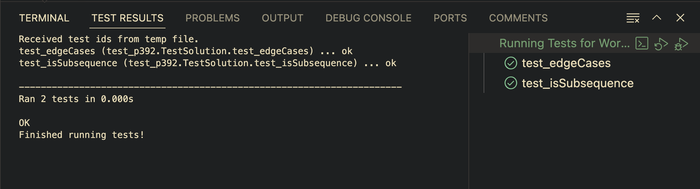
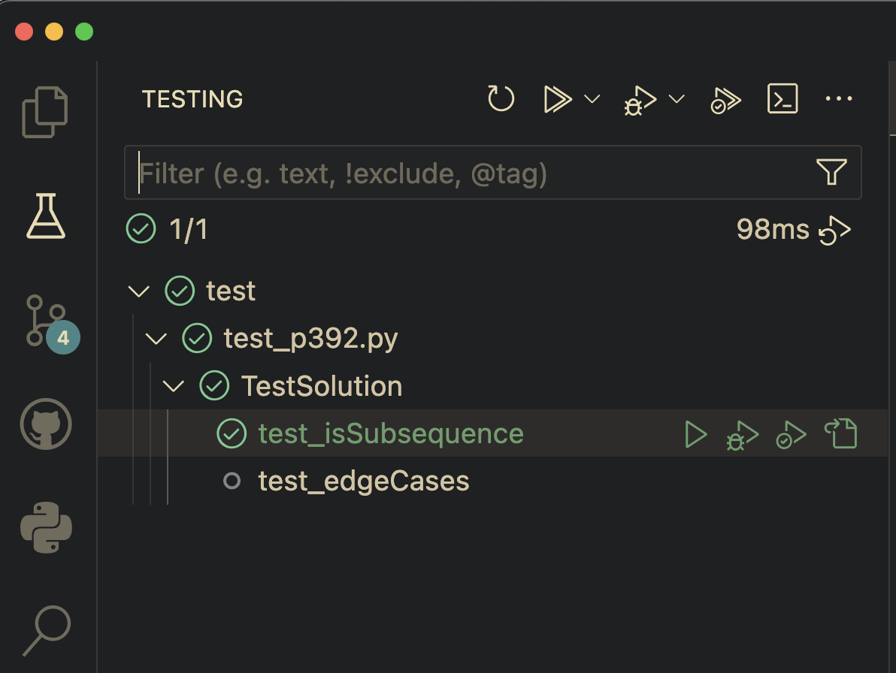

# leetcode-py

Practice and solutions of Leetcode problems in Python


## Naming and problems organization

The top-level container for all problems is `problems` directory. Each problem has its own subdirectory which matches `pXXX` format, where `XXX` are the digits representing problem number on Leetcode. For example `problems/p392` contains solution for [P392](https://leetcode.com/problems/is-subsequence/description/).
Inside each specific problem directory there are two files:
- `pXXX.py`: contains a solution to the problem
- `prob.md`: contains a description of the problem

Due to the challenges with `unittest` discovery in VS Code:
- top level container for all tests (for all problems) is `problems/test` directory
- inside `problems/test` directory, all tests for specific problem `pXXX` are inside `problems/test/test_pXXX.py`


## Running tests

There are many ways how tests can be run, depending on what scope is targeted. Below are just some of the examples.

### From the console

**NOTE:** Base starting directory for running all unittest commands in CLI should always be `{projectRoot}/problems` directory.

- To run all tests, run following:
  
  ```bash
  cd leetcode/problems #problems dir
  python -m unittest discover -v -s test
  ```

- To run just edge case tests for all problems, run following:

    
  ```bash
  cd leetcode-py/problems # problems dir
  python -m unittest discover -v -s test -k "edge"
  ```

- To run all tests for `p392`, run following:

  ```bash
  cd leetcode-py/problems # problems dir
  python -m unittest discover -v -s test -p "*392*.py"
  ```
  The above should output:
  ```txt
  test_isSubsequence (test_p392.TestSolution.test_isSubsequence) ... ok
  test_isSubsequence_edge_cases (test_p392.TestSolution.test_isSubsequence_edge_cases) ... ok
  
  ----------------------------------------------------------------------
  Ran 2 tests in 0.000s

  OK
  ```

- To run specific test for `p392`, run following:

  ```bash
  cd leetcode-py/problems # problems dir
  python -m unittest discover -v -s test -p "*392*.py" -k "isSubsequence"
  ```


### From the VS Code

Configure `{project-root}/.vscode/settings.json` with the following:

```json
{
    "python.testing.pytestEnabled": false,
    "python.testing.autoTestDiscoverOnSaveEnabled": true,
    "python.testing.cwd": "${workspaceFolder}",
    "python.testing.unittestEnabled": true,
    "python.testing.unittestArgs": [
        "-v",
        "-s",
        "./problems/test",
        "-p",
        "*test*.py"
    ],
}
```


To run all tests from VS Code:
- Assume that you opened repo root directory in VS Code (`leetcode-py` is `${workspaceFolder}` and opened in VS Code).
- Right click `problems` directory in VS Code.
- Run command: `Run All Tests`.
- On the bottom of VS Code window, there should be a panel with test results and output.
  
- On the left menu-bar there is also an icon for tests. Click on it to see all available options for all discovered tests and to filter through them.
  


## Math expressions rendering

Some problems use Latex expressionsin their description. GitHub [supports math expressions](https://docs.github.com/en/get-started/writing-on-github/working-with-advanced-formatting/writing-mathematical-expressions) in its own markdown spec, and for rerendering it is using [MathJax](https://www.mathjax.org/) library.
To allow local rendering of markdown files with problem descriptions, one option on VS Code is to use [Markdown Enhanced Plugin](https://marketplace.visualstudio.com/items?itemName=shd101wyy.markdown-preview-enhanced) and [configure](https://shd101wyy.github.io/markdown-preview-enhanced/#/usages?id=vs-code) VS Code plugin setting `markdown-preview-enhanced.mathRenderingOption` to use `MathJax` as default rendering option. So either in global `settings.json` or workspace-specific `settings.json`, you would configure:
```json
"markdown-preview-enhanced": {
    "mathRenderingOption": "MathJax"
}
```