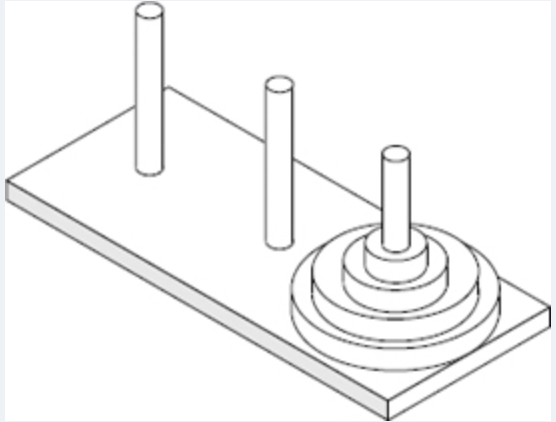

# The Towers Of Hanoi

In the **Towers of Hanoi** puzzle, we are given a platform with three pegs, _a_, _b_, and _c_, sticking out of it. On peg _a_ is a stack of _n_ disks, each larger than the next, so that the smallest is on the top and the largest is on the bottom. The puzzle is to move all the disks from peg _a_ to peg _c_, moving one disk at a time, so that we never place a larger disk on top of a smaller one. See image for an example of the case _n_ = 4. Describe a recursive algorithm for solving the Towers of Hanoi puzzle for arbitrary _n_. (Hint: Consider first the subproblem of moving all but the nth disk from peg a to another peg using the third as “temporary storage.”)

**Example 1:**

Articles:
- https://leetcode.com/discuss/post/5272714/tower-of-hanoi-by-satvikmpatil-owd6/
- https://leetcode.com/discuss/post/6326188/efficient-tower-of-hanoi-beyond-the-basi-pprs/

**Labels:** `recursion`
